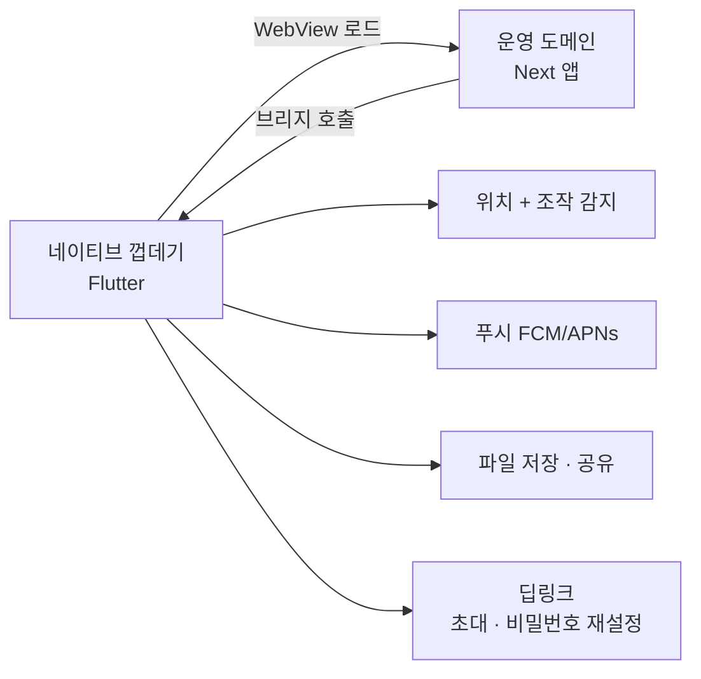

# 웹뷰 앱 제작 — 해야 할 일

> 한 줄 요약: **네이티브 껍데기(Flutter)가 직원 웹(Next 앱)을 그대로 띄운다.** 화면은 웹을 그대로 쓰고, 웹이 못 하는 것(위치 조작 감지 · 파일 받기 · 푸시 · 딥링크)을 앱이 채운다. 정식 출시 목표 **2027년 2월 말**.

> [!summary] 지금 상태 (2026-11-24)
> - **1단계 껍데기 · 2단계 위치 · 파일은 코드가 끝났다.** 협의 없이 할 수 있는 코드 작업(출시용 서명 틀 · 기기 식별자 · 서명 중 새로고침 끄기 · 급여 PDF 실패 안내)도 끝났다(앱 PR #9 · 웹 PR #97). 남은 것은 테스트 계정으로 실제 로그인해 휴대전화에서 확인하는 일이다.
> - **3단계 딥링크 · 4단계 푸시 · 5단계 스토어는 협의가 먼저다** — 번들 ID 확정, 회사 개발자 계정, api 팀 협의. 회의 안건은 [[출시-협의-안건]].
> - 코드와 계획을 비교한 자세한 현황은 앱 저장소 `docs/progress.md`, 웹 ↔ 앱 약속은 `docs/native-bridge.md`. 명세 보관소에는 「설치형 앱 (웹뷰 껍데기)」 기능(F-WVSHAP)으로 올라가 있다.

---

## 0. 기본 구조

| 항목 | 정한 것 | 이유 |
| --- | --- | --- |
| 껍데기 기술 | **Flutter + `flutter_inappwebview`** (2026-11-19, 처음엔 Capacitor) | Flutter 저장소에서 1단계가 먼저 끝나 그대로 간다. 아래 「껍데기 기술」 참고 |
| 화면 싣는 방식 | **원격 URL 로드** | 서버 액션 · SSR · httpOnly 쿠키(`access_token` · `refresh_token` · `password_reset` 등)를 써서 정적 번들로 넣을 수 없다 |
| 환경 | 개발 `staff-dev.whaleerp.co.kr` · 운영 `staff.whaleerp.co.kr` 두 개를 빌드 설정으로 나눔, 스테이징 없음 (2026-11-13 회의). 운영 도메인은 2026-11-19 현재 DNS 미등록 | QA 앱은 개발 도메인을 본다 |

### 껍데기 기술 — Flutter (2026-11-19)

- 웹 ↔ 앱 브리지를 직접 짠다. 앱은 `addJavaScriptHandler`, 웹은 `window.flutter_inappwebview.callHandler(이름, …)` 로 부르고, 웹 `src/lib/native-bridge.ts` 한 곳이 이 호출을 감싼다
- 브리지는 **직원 웹 HTTPS 출처(`WEB_URL`)의 맨 위 화면에서 온 호출만** 받는다. 출처 · 프레임이 다르면 `forbidden`. User-Agent(`WhaleStaffApp/<앱 버전>`)는 앱 안인지 감지하는 데만 쓰고 권한 확인에는 쓰지 않는다 (2026-11-20, PR 리뷰 반영)
- 쓰는 패키지: 위치 `geolocator`(앱이 좌표와 조작 여부를 함께 잼, 결정 8), 공유 `share_plus`. 앞으로: 푸시 `firebase_messaging`, 딥링크 `app_links`(안)
- 파일 받기는 브리지 없이 **앱이 가로채 받는다** — 급여 PDF 는 웹뷰 쿠키를 실어 받고, 계약서는 S3 서명 주소로 가는 이동을 막고 받는다(결정 10, 2026-11-23)

> [!note]- 이전 결정 — Capacitor (2026-11-13, 2026-11-19 변경됨)
> 팀이 Next · TypeScript 로 일해 웹 코드에서 공식 플러그인(위치 · 푸시 · 공유 · 딥링크)을 TS 로 바로 부를 수 있어 골랐다. Flutter 저장소로 1단계가 먼저 끝나 바꿨다. Expo 는 홈 · 출퇴근 일부를 네이티브 화면으로 바꿀 계획이 있을 때만 나았다.

### 저장소 구성

| 저장소 | 할 일 |
|---|---|
| `whale-erp-new-staff` (웹) | viewport, 웹뷰 감지 · 브리지 모듈, 위치 조작 감지 연결, 기기 식별자, `assetlinks.json` · `apple-app-site-association` |
| `whale-erp-staff-mobile-app` (Flutter 껍데기) | 위치 권한 · 측정, 파일 받기, 뒤로 가기, 쿠키 유지, 푸시, 딥링크 설정, 아이콘 · 스플래시, 스토어 빌드 · 서명 |

원격 URL 방식이라 웹을 고쳐도 앱을 다시 빌드하지 않는다. 배포 주기(웹 머지 즉시 · 앱 스토어 심사)와 도구(Xcode · Android Studio · 서명 키)가 달라 저장소를 나눈다.

---

## 1. 웹(`whale-erp-new-staff`)에서 할 일

- [x] **viewport** — `viewportFit: "cover"` + `themeColor` 로 노치 · 홈 바 여백(`env(safe-area-inset-*)`)이 동작하게 (웹 PR #91, 2026-11-24)
- [x] **웹뷰 감지 · 브리지** — UA 접미사 `WhaleStaffApp/<앱 버전>` 으로 판별, 네이티브 호출은 `src/lib/native-bridge.ts` 한 곳에 (웹 PR #87, 2026-11-23)
- [x] **위치 조작 감지 연결** — 앱 안에서는 출퇴근 화면이 앱이 잰 좌표와 조작 여부(`measureLocation`)를 쓴다. 웹에선 알 수 없어 앱이 넘긴다(Android `Location.isMock()`, iOS 15+ `isSimulatedBySoftware`). 앱 연결이 잠깐 안 되면 「다시 시도」 버튼을 보이고 브라우저 위치로 넘기지 않는다 (웹 PR #90 · #91, 2026-11-23 ~ 24)
- [x] **오프라인 · 오류 화면** — 원격 URL 이 안 열릴 때 네이티브 다시 시도 화면 (앱에서 처리, 2026-11-19)
- [x] **뒤로 가기 · 파일 받기** — 웹을 고치지 않고 앱이 처리하기로 했다(아래 2절)
- [x] **기기 식별자** — 쿠키 UUID 는 앱을 지우면 바뀐다. 앱 안에서는 로그인 때 앱이 준 기기 식별자(기기 고유값의 SHA-256 해시, 원래 값은 앱 밖으로 안 나감)를 쓰고, 로그인에 성공하면 쿠키에도 남긴다(결정 9, 웹 PR #97 · 앱 PR #9, 2026-11-24)
- [x] **당겨서 새로고침과 서명 패드** — 서명 패드(`touch-none`)가 화면에 보이는 동안 앱이 당겨서 새로고침을 미리 끄고, 사라지면 다시 켠다. 웹은 고치지 않았다(앱 PR #9, 2026-11-24). *실기기 확인 남음*
- [x] **급여 PDF 실패 화면** — 실패하면 평문 글자 대신 명세서 상세로 돌려보내 안내를 띄운다(계약서 받기와 같은 방식, `download` 속성 뺌). 앱도 그 안내 화면을 연다(웹 PR #97 · 앱 PR #9, 2026-11-24)
- [ ] **재영님 참고 2건 (블로커 아님, 다음에 손볼 때)** (웹 PR #97 머지 댓글, 2026-11-24)
  - 명세서가 지워져 돌아온 화면(`?download=notfound`)은 주소에서 값을 지우지 않아, 안내대로 새로 고치면 같은 안내가 또 뜬다
  - 쿠키 UUID 에서 앱 식별자로 바뀌는 첫 로그인 때 같은 휴대전화의 옛 접속이 서버에 최대 30일 남는다(쓸 수는 없음). 정리하려면 api 와 정한다
- [ ] **`assetlinks.json` · `apple-app-site-association`** — 번들 ID 확정 뒤 (3단계)

## 2. 네이티브 껍데기에서 할 일

- [x] **외부 링크** — 같은 도메인은 웹뷰 안, 그 밖은 외부 브라우저 (2026-11-19)
- [x] **아이콘 · 스플래시 · 앱 이름** — 후보 A, 「웨일ERP 직원」, iPhone 전용 · 세로 고정 (앱 PR #2, 2026-11-20)
- [x] **안드로이드 뒤로 가기** — 열린 바텀시트를 가장 나중에 연 것부터 닫고, 없으면 웹 기록 → 앱 종료 (앱 PR #6, 2026-11-23)
- [x] **위치 권한 · 측정** — iOS 사용 중 위치 사유 문구, Android 런타임 권한, 대략적 위치면 정확한 위치 다시 요청, 거부 · 위치 꺼짐이면 설정 안내. 앱 안 출퇴근은 앱이 새로 잰 좌표와 조작 여부를 넘긴다 (앱 PR #3 · #4, 2026-11-20 ~ 23). *실기기 확인 남음*
- [x] **파일 받기** — 급여 PDF · 계약서를 앱이 받아 공유 시트로 연다 (앱 PR #5, 2026-11-23). *로그인한 실제 받기 확인 남음*
- [x] **쿠키 유지** — 자동 로그인 켜면 30일, 끄면 7일(`src/lib/session-cookies.ts`). Android 는 앱을 내릴 때 쿠키를 저장한다(`CookieManager.flush()`), iOS 는 웹뷰가 스스로 저장 (앱 PR #8, 2026-11-24). *실제 로그인 유지 확인 남음*
- [ ] **키보드** — Android `adjustResize`. 하단 `sticky` Dock 이 키보드에 가리지 않는지 실기기 확인
- [ ] **딥링크(App Links · Universal Links)** — api(`src/auth/staff-app-url.ts`)가 `STAFF_APP_URL` 로 만드는 링크 세 가지: 알림톡 가입 초대(`/invite#token=…`), 비밀번호 재설정(`/password-reset/link#token=…`), 소속 추가 확인 요청(`/affiliations`). 도메인에 `assetlinks.json` · `apple-app-site-association` 을 올리고, `#` 뒤 토큰이 앱으로 넘어오는지, 카카오톡 인앱 브라우저에서 앱이 뜨는지 실기기로 확인 — **번들 ID 확정 뒤**
- [ ] **푸시(FCM · APNs)** — 무엇을 언제 보낼지는 명세 보관소 알림 정책(NTF)에 다 정해져 있다(알림 4가지 · 템플릿 5종 · 수신 설정 4묶음). 받는 쪽이 없어 api 는 발송 대기 줄만 쌓는다(api 이슈 #261 · #321). 토큰 발급 → api 등록 → 알림 누르면 해당 화면 — **토큰 등록 API 는 api 팀과 협의**
- [ ] **강제 업데이트** — 앱 시작 때 api 의 최소 앱 버전을 확인 (결정 12, **값은 api 팀 협의**)
- [ ] **릴리즈 서명 · iOS 프로비저닝** — Android 는 `android/key.properties` 가 있으면 출시용 키로 서명하는 틀을 넣었다(없으면 debug 키 + 경고, 앱 PR #9). 남은 것: 실제 키를 만들고 보관할 사람(결정 16), iOS 는 회사 Apple 계정이 생긴 뒤
- [ ] **운영 주소 전환** — 도메인이 열리면 앱 기본 주소를 `staff.whaleerp.co.kr` 로

## 3. 스토어 심사 대비

- [ ] **Apple 4.2 최소 기능** — 단순 웹 래핑은 반려될 수 있다. 네이티브 위치 측정 · 파일 받기는 들어갔고 푸시가 붙으면 근거가 더 단단해진다
- [ ] **앱 안 계정 삭제 (Apple 5.1.1(v))** — 명세 보관소 「직원 회원 탈퇴」가 기획 확정됐고 웹 · api 작업 중 (WHALEERP-770, 2026-11-24 노영주). 앱은 웹 화면을 띄우므로 따로 만들지 않는다
- [ ] **Google Play 웹 계정 삭제 요청 경로** — 앱 안 탈퇴와 별도로 스토어 등록 때 요구한다. 어디에 둘지 정해야 한다
- [ ] **개인정보 처리방침 · 고객지원 URL** — 처리방침은 별도 문서로 새로 만들어야 한다(명세 보관소 안에서도 정리가 필요, [[출시-협의-안건]] 8번)
- [ ] **위치 권한 사유 문구 · Google Play 데이터 보안 양식** — iOS 사유 문구는 넣었다(「출퇴근을 기록할 때 근무지 근처에 있는지 확인하려고 현재 위치를 사용합니다.」). 문구 확정과 데이터 보안 양식이 남았다. 양식에는 위치와 함께 **기기 ID**(로그인 기기 식별, 해시)를 적는다
- [ ] **iOS 업로드 「항상 허용」 경고(ITMS-90683)** — App Store 빌드는 `BYPASS_PERMISSION_LOCATION_ALWAYS=1` 로 빌드한다(앱 저장소 CLAUDE.md)

## 4. 진행 순서

| 단계 | 내용 | 상태 (2026-11-24) |
| --- | --- | --- |
| 1 | 껍데기 + 개발 URL — 로그인 · 쿠키 유지 · safe area · 뒤로 가기 | 코드 끝 · 실기기 확인 남음 |
| 2 | 위치 권한 · 조작 감지 브리지 · 파일 받기 (출퇴근 · 급여가 핵심) | 코드 끝 · 실기기 확인 남음 |
| 3 | 딥링크 (초대 · 비밀번호 재설정) | 번들 ID 확정 뒤 |
| 4 | 푸시 (api 토큰 등록 협의 먼저) | api 협의 뒤 |
| 5 | 스토어 준비물 → 내부 테스트(TestFlight · 내부 트랙) | 회사 계정 · 처리방침 뒤 |

> [!note] 번들 ID 없이 먼저 시작 (2026-11-17, 2026-11-19 보류)
> 번들 ID(결정 2번)는 **외부에 등록하는 순간** 바꿀 수 없게 된다. 로컬에서는 언제든 바꿀 수 있어 1 · 2단계는 임시 ID 로 진행하고, **3단계 딥링크 전까지 확정**한다. 앱 저장소는 지금 `kr.co.whaleerp.staff` 를 로컬에서만 쓴다(외부 등록 없음).
> - 바꿀 곳: iOS `PRODUCT_BUNDLE_IDENTIFIER`(`ios/Runner.xcodeproj/project.pbxproj`) · Android `applicationId`(`android/app/build.gradle.kts`). Android 는 `namespace` 를 따로 두어 코드 패키지 경로는 그대로 둔다
> - 임시 ID 로 **하지 않을 것**: Apple App ID · 프로비저닝 프로필, Firebase 앱 등록, Play Console 업로드(한 번 올리면 패키지명 영구 고정), `assetlinks.json` · `apple-app-site-association` 배포
>
> | 단계 | 확정 번들 ID |
> |---|---|
> | 1 · 2 | 필요 없음 (실기기는 개인 무료 서명으로 가능) |
> | 3 딥링크 · 4 푸시 · 5 내부 테스트 | 필요 |

---

## 결정 사항

> 2026-11-13 회의 — 결정 14건(1 · 3~12 · 15 · 17), 보류 1건(16), 미정 3건(2 번들 ID, 13 탈퇴, 14 처리방침 · 고객지원). 회의 기록 원본: https://claude.ai/artifact/BYXbJ81AgcKnzyz5rjYMrT
> 아직 열린 것(2 · 13 · 14 · 16 · 17 일부, 11 · 12 의 api 협의)은 [[출시-협의-안건]] 에서 다룬다.

### A. 프로젝트 만들기 전 (나중에 바꾸기 어려움)

| #   | 정할 것                              | 추천                                                                      | 결정                                                            |
| --- | --------------------------------- | ----------------------------------------------------------------------- | ------------------------------------------------------------- |
| 1   | 저장소 이름 · 위치                       | `nalpari/whale-erp-staff-app`                                           | **결정** — `nalpari/whale-erp-staff-mobile-app` (2026-11-13 회의) |
| 2   | **번들 ID / 패키지명** (스토어 등록 후 변경 불가) | `kr.co.<회사도메인>.whaleerp.staff` 형식                                       | **보류** (2026-11-19). **3단계 딥링크 전까지 확정** — 그전엔 임시 ID 로 로컬 진행 (2026-11-17). 앱 저장소는 지금 `kr.co.whaleerp.staff` 를 로컬에서만 쓴다 |
| 3   | 스토어 표시 앱 이름                       | 짧게(예 「웨일ERP 직원」), 홈 화면 아이콘 아래 잘리지 않게                                    | **결정** — 「웨일ERP 직원」 (2026-11-13 회의)                           |
| 4   | 최소 지원 OS                          | iOS 15+(위치 조작 감지 API 가 15부터), Android 8(API 26)+                        | **변경** — **iOS 15.4+** (2026-11-20, 바텀시트 `<dialog>` 가 Safari · WKWebView 15.4 부터 동작) · **Android 7(API 24)+** (2026-11-19). 처음 결정은 iOS 15+ · Android 8(API 26)+ (2026-11-13 회의). Android 위치 조작 감지는 API 31+ `Location.isMock()`, 그 아래는 `isFromMockProvider()` |
| 5   | 기기 범위 · 화면 방향                     | 휴대전화 전용 · 세로 고정. iPad 지원하면 iPad 스크린샷 · 심사 대응 추가. 폴더블은 Android 에서 그대로 지원 | **결정** — 휴대전화 전용 · 세로 고정 (2026-11-13 회의)                      |

### B. 기능 설계

| # | 정할 것 | 추천 | 결정 |
|---|---|---|---|
| 6 | 환경별 URL | 개발 · 스테이징 · 운영 도메인 3개를 빌드 설정으로 나눈다(실제 도메인 확인 필요) | **결정** — 개발 `staff-dev.whaleerp.co.kr` · 운영 `staff.whaleerp.co.kr`, **스테이징 없음** (2026-11-13 회의) |
| 7 | 딥링크 경로 | `/invite` · `/affiliations` · `/password-reset/link` 를 앱에서 연다(2026-11-19 수정: 처음엔 `/join` 이었으나 밖에서 들어오는 링크가 아니라 빼고, api 가 보내는 `/affiliations` 를 넣음). 앱이 없으면 웹으로. 도메인에 `assetlinks.json` · `apple-app-site-association` | **결정** — 추천대로 (2026-11-13 회의) |
| 8 | 위치 조작 감지 | 앱 안에서는 **네이티브가 좌표와 조작 여부(`isMock`)를 한 번에 측정해 함께 넘긴다**. 웹은 앱 안이면 `navigator.geolocation` 대신 브리지 값을 쓰고, 앱 밖(브라우저)에서는 지금처럼 geolocation + `mocked: false` | **변경** (2026-11-20) — 좌표 · 조작 여부를 네이티브가 함께 넘긴다. 조작 여부가 웹이 따로 받은 좌표가 아니라 같은 측정값에 대한 것이어야 판정이 맞다. 처음 결정은 「위치는 웹 geolocation, `isMock` 만 네이티브」(2026-11-13 회의). **구현 끝** (앱 PR #4 · 웹 PR #90) |
| 9 | 기기 식별자 | 앱 안에서는 네이티브 ID 를 넘겨 `getDeviceId()` 대신 쓴다. 웹은 지금처럼 쿠키 UUID | **결정** — 추천대로 (2026-11-13 회의). 네이티브 ID 는 해시로 넘긴다(2026-11-24 창수). **구현 끝** (앱 PR #9 · 웹 PR #97) |
| 10 | 파일 받기 | 공유 시트로 연다(저장 · 카톡 전송을 사용자가 고름). 앱 안에선 웹을 고치지 않고 **앱이 가로채 받는다** — 급여 PDF 는 웹뷰 쿠키를 실어 받고, 계약서는 S3 서명 주소로 가는 이동을 막고 받는다 | **결정** — 추천대로 (2026-11-13 회의). **바꿈** (2026-11-23 창수) — 처음 문구 「급여 PDF · 계약서 링크를 앱 안에선 브리지로」 대신 가로채기. **구현 끝** (앱 PR #5) |
| 11 | 푸시 | FCM 프로젝트는 회사 Google 계정으로. 토큰 등록 API 를 api 팀과 협의 · 일정 | **결정** — 추천대로 (토큰 등록 API 는 api 팀 협의) (2026-11-13 회의) |
| 12 | 강제 업데이트 | api 에 최소 앱 버전 값을 두고 앱 시작 때 확인(api 팀 협의) | **결정** — 추천대로 (최소 앱 버전 값은 api 팀 협의) (2026-11-13 회의) |

### C. 출시 전

| # | 정할 것 | 추천 | 결정 |
|---|---|---|---|
| 13 | **앱 안 계정 삭제(탈퇴)** | Apple 필수(5.1.1(v)). 기획 · api · 화면을 새로 만든다. 근로계약 · 급여명세서 보존 정책부터 정한다 | 미정 — 정책 수정 후 반영 (2026-11-13 회의). **진행 중** — 명세 보관소 「직원 회원 탈퇴」 기획 확정, 웹 · api 작업 중(WHALEERP-770, 2026-11-24 노영주). 남은 것: 탈퇴 메일 · 관리자 알림 문구 확정, Google Play 웹 삭제 경로 |
| 14 | 개인정보 처리방침 · 고객지원 URL | 직원 앱까지 아우르는 처리방침 본문 · 공개 URL 을 새로 만든다(위치정보 · 근로 · 급여 정보 포함). 고객지원은 회사 사이트에 공개 지원 페이지 하나. *참고(2026-11-13 확인): 관리자 웹 푸터 「개인정보처리방침」은 BP 회원가입용 「개인정보 수집·이용 동의」(`/terms#PRIVACY_COLLECT`)를 열고, api 약관 유형 6종에 처리방침이 없다. 수집·이용 동의는 법정 처리방침(보호법 30조)을 대신하지 못한다. 고객지원은 BP용 도입문의(`/leads`) · 공지(`/notices`)와 회사 연락처(master@interplug.co.kr · 02-6928-0028)뿐, 직원 앱엔 문의 · FAQ 화면이 없다* | 미정 — 정책 수정 후 반영 (2026-11-13 회의) |
| 15 | 아이콘 · 스플래시 | 아래 「아이콘 · 스플래시」로 확정 | **시안으로 확정 (2026-11-13)**, 2026-11-20 후보 A 로 바꿈 |
| 16 | 빌드 · 배포 담당과 맥 | iOS 빌드는 맥 필요. 서명 인증서 보관자 정하기 | **보류** — 임시 담당 김창수 (2026-11-13) |
| 17 | 출시 일정 | 내부 테스트 시작일 · 정식 출시일 | **정식 출시 2027년 2월 말 (2026-11-13)**. 내부 테스트 시작일 미정 |

- [x] 껍데기 기술: **Flutter** (2026-11-19, 처음엔 Capacitor 2026-11-13)
- [x] A 1 · 3 · 4 · 5 결정 (2026-11-13 회의, 4번은 2026-11-19 · 20 변경)
- [ ] A 2 번들 ID — 보류 (2026-11-19). 3단계 딥링크 전까지 확정
- [x] 웹뷰 감지 User-Agent `WhaleStaffApp/<앱 버전>` (2026-11-19)
- [x] B 6~12 결정 (2026-11-13 회의, 8 · 10 은 바꿔서 구현 끝)
- [ ] api 팀 협의: 푸시 토큰 등록 API(11) · 최소 앱 버전(12)
- [x] C 15 아이콘 · 스플래시 (2026-11-13, 2026-11-20 후보 A)
- [x] C 17 정식 출시 2027년 2월 말 (2026-11-13)
- [ ] C 13 · 14 정책 수정 후 결정, 16 정식 담당(보류), 17 내부 테스트 시작일

---

## 아이콘 · 스플래시 — 확정 (2026-11-20 후보 A)

남보라(#4C4DDC) 바탕에 흰 고래. 스플래시는 고래 위에 별 세 개, 로딩 표시 없음. 원본은 앱 저장소 `assets/source/` 에 넣었다.

| 파일 (`~/Downloads/icons/candidates/`) | 크기 | 쓰는 곳 |
|---|---|---|
| `icon-a.png` | 1024 · 알파 없음 | iOS 앱 아이콘 · App Store 제출용, Android 7 이하 아이콘 |
| `fg-solid.png` | 1024 · 투명 | Android 적응형 아이콘 앞면 · Android 13+ 테마 아이콘 (뒷면은 #4C4DDC 단색) |
| `splash-a.png` | 1296×2800 | 스플래시 (고래와 별만 잘라 가운데에 두고 바탕은 #4C4DDC 단색) |

- 같은 폴더의 icon-b · splash-b · fg-transparent, `~/Downloads/icons/` 바로 아래 평면 버전은 쓰지 않는다
- `flutter_launcher_icons`(아이콘) · `flutter_native_splash`(스플래시) 로 플랫폼별 크기를 뽑는다. Android 12+ 는 시스템 스플래시라 **가운데 아이콘 + 바탕색**으로 나온다

---

## 변경 이력

- **2026-11-24 (오후)** — 협의 없이 할 수 있는 코드 작업 마무리: Android 출시용 서명 틀, 기기 식별자(해시), 서명 패드가 보이는 동안 당겨서 새로고침 끄기, 급여 PDF 실패 때 상세로 돌려보내 안내(앱 PR #9 · 웹 PR #97). 재영님 참고 2건을 1절에 적음
- **2026-11-24** — viewport · 앱 연결 장애 「다시 시도」 · 위치 오류 기록에서 좌표 빼기(웹 PR #91), 쿠키 유지(앱 PR #8). 1 · 2단계 코드 끝. 앱 안 탈퇴 작업 시작(WHALEERP-770). 협의 안건을 [[출시-협의-안건]] 으로 분리. 이 노트를 지금 상태 기준으로 다시 정리
- **2026-11-23** — 브리지 모듈(웹 PR #87), 위치 측정(앱 PR #4 · 웹 PR #90), 파일 받기(앱 PR #5, 결정 10 바꿈), 뒤로 가기로 바텀시트 닫기(앱 PR #6)
- **2026-11-20** — 결정 8 변경(앱이 좌표와 조작 여부를 함께 잼), 최소 iOS 15.4+, 아이콘 후보 A, 1단계 마무리(앱 PR #2) · 위치 권한(앱 PR #3)
- **2026-11-19** — 껍데기 기술 Capacitor → Flutter, 최소 Android 7(API 24)+, 번들 ID 보류, User-Agent `WhaleStaffApp/<앱 버전>` 확정. 웹(`4717743`) · api(`f40368ec`) 대조: 웹 저장소 이름 `whale-erp-new-staff`, 딥링크 경로 `/join` → `/affiliations`, 계약서는 S3 서명 주소로 302 · 급여 PDF 는 같은 호스트 attachment, 운영 도메인 DNS 미등록
- **2026-11-13** — 계획 작성, 회의에서 17건 중 14건 결정
