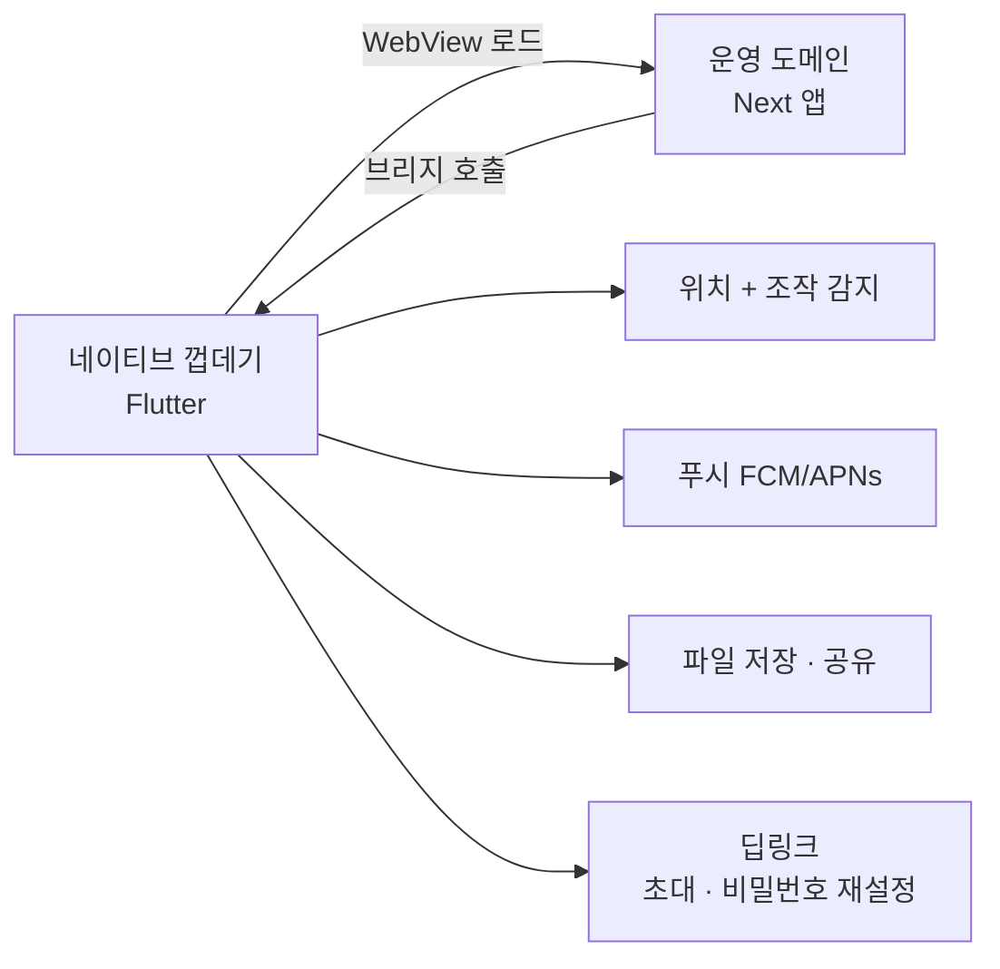

# 웹뷰 앱 제작 — 해야 할 일

> 한 줄 요약: **네이티브 껍데기가 운영 도메인의 Next 앱을 그대로 띄운다.** 화면은 그대로 쓰고, 웹이 못 하는 것(위치 조작 감지 · 파일 받기 · 푸시 · 딥링크)을 네이티브가 채운다.

> [!important] 2026-11-19 결정 변경
> - 껍데기 기술: Capacitor → **Flutter** (`flutter_inappwebview`). 저장소 `nalpari/whale-erp-staff-mobile-app` 이 Flutter 로 만들어져 1단계가 끝난 상태
> - 최소 지원 Android: 8 (API 26) → **7 (API 24)**. iOS 는 그대로 15+ · 휴대전화 전용
> - 번들 ID: **보류** (지금 앱은 로컬에서만 `kr.co.whaleerp.staff` 사용, 외부 등록 없음)
> - 그대로 유지: 아이콘 · 스플래시 시안(15), 앱 이름 「웨일ERP 직원」(3), 운영 URL `staff.whaleerp.co.kr`(6)
> - 웹뷰 감지 User-Agent: **`WhaleStaffApp/<앱 버전>`** (예 `WhaleStaffApp/1.0`) 로 확정
>
> 앱 저장소의 `docs/progress.md` 가 이 문서와 코드를 비교해 남은 일을 관리한다.

---

## 0. 먼저 정할 것

| 항목       | 권장                                                                                                 | 이유                                                                                                  |
| -------- | -------------------------------------------------------------------------------------------------- | --------------------------------------------------------------------------------------------------- |
| 껍데기 기술   | **Flutter + `flutter_inappwebview` (2026-11-19 변경, 처음 결정은 Capacitor 2026-11-13)**                  | 아래 「껍데기 기술 결정」 참고                                                                                   |
| 화면 싣는 방식 | **원격 URL 로드**                                                                                      | 서버 액션 · SSR · httpOnly 쿠키(`access_token` · `refresh_token` · `password_reset` 등)를 써서 정적 번들로 넣을 수 없다 |
| 환경       | 개발 `staff-dev.whaleerp.co.kr` · 운영 `staff.whaleerp.co.kr` 두 개를 빌드 설정으로 나눔, 스테이징 없음 (2026-11-13 회의) | QA 앱은 개발 도메인을 본다                                                                                    |

### 껍데기 기술 결정 — Flutter (2026-11-19)

Flutter 로 만든 앱 저장소(`whale-erp-staff-mobile-app`)에서 1단계(원격 URL 로드 · 외부 링크 · 뒤로 가기 · 오류 화면 · 스플래시)가 끝나 그대로 간다.

**Capacitor 와 달라지는 점**
- 웹 ↔ 앱 브리지를 직접 짠다. 앱은 `addJavaScriptHandler`, 웹은 `window.flutter_inappwebview.callHandler(이름, …)` 로 부른다. 웹의 `src/lib/native-bridge.ts` 가 이 호출을 감싼다
- 공식 플러그인 대신 pub.dev 패키지를 쓴다(안): 푸시 `firebase_messaging`, 공유 `share_plus`, 딥링크 `app_links`. 위치는 웹 geolocation 을 그대로 쓰고 조작 감지만 네이티브 코드로 넘긴다
- 원격 URL 로드에서 브리지가 붙는지는 문제가 아니다(`flutter_inappwebview` 는 원격 페이지에도 핸들러를 붙인다)
- `download` 링크는 여전히 웹뷰가 처리하지 않는다. 앱에서 `onDownloadStartRequest` 로 받거나 웹이 브리지로 넘긴다

#### 이전 결정 — Capacitor (2026-11-13, 2026-11-19 변경됨)

**고른 이유**
- 팀이 Next · TypeScript 로 일한다. 웹 코드에서 `Geolocation` · `PushNotifications` · `Share` 플러그인을 TS 로 바로 부른다. Expo 는 RN 층이 하나 더 생기고 웹 ↔ RN `postMessage` 브리지를 직접 짜야 한다
- 위치 권한 · 푸시(FCM · APNs) · 파일 저장 · 공유 · 딥링크 · 상태바 · 스플래시가 공식 플러그인으로 있다
- 직접 짤 네이티브 코드는 위치 조작 감지(`isMock`) 정도다. Expo 를 골라도 똑같이 네이티브로 짜야 한다
- 앱이 할 일은 웹을 띄우고 네이티브 기능 몇 개를 붙이는 것뿐이라 RN 런타임이 필요 없다

**알고 갈 점**
- 원격 URL 로드(`server.url`)는 문서상 주로 개발용 라이브 리로드로 설명된다. 운영 도메인을 띄웠을 때 플러그인 브리지가 붙는지 **1단계에서 먼저 확인**한다
- `download` 링크는 웹뷰가 처리하지 않는다. 웹 쪽에서 앱 안이면 브리지로 받게 바꾼다

**Expo 가 나았을 경우**: 홈 · 출퇴근 일부를 네이티브 화면으로 바꿀 계획이 있을 때. 지금은 웹 화면을 그대로 쓴다

### 저장소 구성

| 저장소 | 할 일 |
|---|---|
| `whale-erp-staff` (웹) | viewport, 웹뷰 감지 · 브리지 모듈, 뒤로 가기 · 다운로드 · 위치 조작 감지 연결, `assetlinks.json` · `apple-app-site-association` |
| `whale-erp-staff-mobile-app` (Flutter 껍데기) | 위치 권한, 푸시, 딥링크 설정, 아이콘 · 스플래시, 스토어 빌드 · 서명 |

원격 URL 방식이라 웹을 고쳐도 앱을 다시 빌드하지 않는다. 배포 주기(웹 머지 즉시 · 앱 스토어 심사)와 도구(Xcode · Android Studio · 서명 키)가 달라 저장소를 나눈다.

---

## 1. 웹(이 저장소)에서 할 일

- [ ] **viewport** — `src/app/layout.tsx` 에 `export const viewport` 가 없다. `viewportFit: "cover"` + `themeColor` 를 넣어야 노치 밑까지 그리고 `env(safe-area-inset-*)` 가 동작한다
- [ ] **웹뷰 감지 · 브리지** — UA 접미사 `WhaleStaffApp/<앱 버전>`(예 `WhaleStaffApp/1.0`, 2026-11-19 확정)으로 판별. 네이티브 호출은 한 모듈(`src/lib/native-bridge.ts`)에 모으고 `window.flutter_inappwebview.callHandler` 를 감싼다
- [ ] **안드로이드 뒤로 가기** — 하드웨어 뒤로 → `history.back()`. 바텀시트(`<dialog>`)가 열려 있으면 시트부터 닫고, 첫 화면이면 앱 종료
- [ ] **당겨서 새로고침 · 오버스크롤 끄기** — `overscroll-behavior: none`. 서명 패드(`contracts/_components/signature-pad.tsx`)에서 화면이 같이 끌리지 않는지 확인
- [ ] **파일 받기** — 급여 PDF(`pay/_components/export-button.tsx` 의 `download` 링크) · 계약서 파일(`contracts/[contractId]/documents/[contractDocumentId]/route.ts`). 웹뷰는 `download` 를 기본 처리하지 않는다 → 네이티브가 저장 · 공유 시트
- [ ] **위치 조작 감지** — `check-in-screen.tsx` 가 `mocked: false` 로 고정이다. 웹에선 알 수 없어 네이티브가 넘겨야 한다(Android `Location.isMock()`, iOS 15+ `sourceInformation.isSimulatedBySoftware`). 그래야 `MOCK_LOCATION` 확인 필요 사유가 실제로 쌓인다
- [ ] **기기 식별자** — `getDeviceId()`(`src/lib/session.ts`)는 쿠키에 굽는 UUID 라 앱을 지우면 바뀐다. 네이티브 ID 를 받아 쓰는 쪽이 낫다
- [x] **오프라인 · 오류 화면** — 원격 URL 이 안 열릴 때 네이티브 쪽 다시 시도 화면 (앱에서 처리, 2026-11-19)

## 2. 네이티브 껍데기에서 할 일

- [ ] **위치 권한** — iOS `NSLocationWhenInUseUsageDescription`, Android 런타임 권한 + `onGeolocationPermissionsShowPrompt`. 웹 · OS 권한이 두 번 뜨지 않게
- [ ] **푸시(FCM · APNs)** — 앱 푸시 템플릿 5종(`PUSH_CONTRACT_SENT` 등)과 수신 설정 묶음은 정의돼 있지만 받는 쪽이 없다. 토큰 발급 → api 등록 → 알림 누르면 해당 화면. **토큰 등록 API 는 api 팀과 정해야 한다**
- [ ] **딥링크(App Links · Universal Links)** — 알림톡 가입 초대(`TALK_STAFF_INVITATION`), 비밀번호 재설정(`/password-reset/link#token=…`). 도메인에 `assetlinks.json` · `apple-app-site-association` 을 올리고, `#` 뒤 토큰이 앱으로 넘어오는지 확인
- [ ] **쿠키 유지** — 자동 로그인 켜면 마지막 사용 후 30일, 끄면 7일(`src/lib/session-cookies.ts`). Android `CookieManager.flush()`, WKWebView 쿠키 저장소 유지
- [x] **외부 링크** — 같은 도메인은 웹뷰 안, 그 밖은 외부 브라우저 (2026-11-19)
- [ ] **키보드** — Android `adjustResize`. 하단 `sticky` Dock 이 키보드에 가리지 않는지
- [ ] **스플래시 · 아이콘 · 상태바 색 · 버전 확인(강제 업데이트)**

## 3. 스토어 심사 대비

- [ ] **Apple 4.2 최소 기능** — 단순 웹 래핑은 반려될 수 있다. 푸시 · 위치 · 파일 저장 같은 네이티브 기능이 통과 근거
- [ ] **Apple 5.1.1(v) 계정 삭제** — 계정을 만들 수 있는 앱은 앱 안에서 탈퇴할 수 있어야 한다. 현재 화면에 있는지 확인 필요
- [ ] **위치 권한 사유 문구 · 개인정보 처리방침 URL · Google Play 데이터 보안 양식**(위치 수집)

## 4. 진행 순서

1. 껍데기 + 개발 URL(`staff-dev.whaleerp.co.kr`) — 로그인 · 쿠키 유지 · safe area · 뒤로 가기
2. 위치 권한 · 조작 감지 브리지 · 파일 받기 (출퇴근 · 급여가 핵심)
3. 딥링크 (초대 · 비밀번호 재설정)
4. 푸시 (api 토큰 등록 협의 먼저)
5. 스토어 준비물 → 내부 테스트(TestFlight · 내부 트랙)

> [!note] 번들 ID 없이 먼저 시작 (2026-11-17, 2026-11-19 보류)
> 번들 ID(결정 2번)는 **외부에 등록하는 순간** 바꿀 수 없게 된다. 로컬에서는 언제든 바꿀 수 있어 1 · 2단계는 임시 ID 로 진행하고, **3단계 딥링크 전까지 확정**한다. 앱 저장소는 지금 `kr.co.whaleerp.staff` 를 로컬에서만 쓴다(외부 등록 없음).
> - 바꿀 곳: iOS `PRODUCT_BUNDLE_IDENTIFIER`(`ios/Runner.xcodeproj/project.pbxproj`) · Android `applicationId`(`android/app/build.gradle.kts`). Android 는 `namespace` 를 따로 두어 코드 패키지 경로는 그대로 둔다
> - 임시 ID 로 **하지 않을 것**: Apple App ID · 프로비저닝 프로필, Firebase 앱 등록, Play Console 업로드(한 번 올리면 패키지명 영구 고정), `assetlinks.json` · `apple-app-site-association` 배포
> - 환경별 접미사(dev · 운영)를 붙일 거면 처음부터 빌드 설정 변수 한 곳에서 관리한다
>
> | 단계 | 확정 번들 ID |
> |---|---|
> | 1 · 2 | 필요 없음 (실기기는 개인 무료 서명으로 가능) |
> | 3 딥링크 · 4 푸시 · 5 내부 테스트 | 필요 |

## 아이콘 · 스플래시 — 확정 (2026-11-13, 2026-11-19 재확인)

> 앱 저장소에는 아직 다른 시안(`#0a0a0a` 바탕에 노란 고래)이 들어가 있다. 이 시안으로 바꿔야 한다 (2026-11-19).

남보라(#4C4DDC) 바탕에 흰 고래. 스플래시는 고래 위에 별 세 개.

| 파일 (`~/Downloads/icons/`) | 크기 | 쓰는 곳 |
|---|---|---|
| `app-icon-1024.png` | 1024 · 알파 없음 | iOS 앱 아이콘 · App Store 제출용 |
| `android-foreground-white.png` | 1024 · 투명 | Android 적응형 아이콘 앞면 |
| `android-background-4C4DDC.png` | 1024 | Android 적응형 아이콘 뒷면 |
| `android-monochrome-black.png` | 1024 · 투명 | Android 13+ 테마 아이콘 |
| `splash-1290x2796.png` | 1290×2796 | 스플래시 |

- 후보안은 `candidates/`(icon-a · b, splash-a · b, fg-solid · transparent)에 있고 `~/Documents/candidates` 는 같은 사본이다. 최종본은 위 표의 평면 버전이다
- 원본을 앱 저장소 `assets/` 에 넣고 `flutter_launcher_icons`(아이콘) · `flutter_native_splash`(스플래시) 로 플랫폼별 크기를 뽑는다. 앱 안 스플래시(`SplashOverlay`)의 색 · 이미지도 같이 바꾼다
- Android 12+ 는 시스템 스플래시 API 라 전체 이미지 대신 **가운데 아이콘 + 바탕색**으로 나온다. 바탕 #4C4DDC + 흰 고래 아이콘으로 맞추면 iOS 와 같은 인상이 된다

## 결정 사항 — 회의에서 정할 것

> 2026-11-13 회의 반영 — 결정 14건(1 · 3~12 · 15 · 17), 보류 1건(16), 미정 3건(2 번들 ID, 13 탈퇴, 14 처리방침 · 고객지원 — 13 · 14 는 정책 수정 후 반영). 회의 기록 원본: https://claude.ai/artifact/BYXbJ81AgcKnzyz5rjYMrT
>
> 2026-11-19 변경 — 껍데기 기술 Flutter, 4번 Android 7(API 24)+, 2번 보류, 3 · 6 · 15번 유지, User-Agent `WhaleStaffApp/<앱 버전>` 확정

### A. 프로젝트 만들기 전 (나중에 바꾸기 어려움)

| #   | 정할 것                              | 추천                                                                      | 결정                                                            |
| --- | --------------------------------- | ----------------------------------------------------------------------- | ------------------------------------------------------------- |
| 1   | 저장소 이름 · 위치                       | `nalpari/whale-erp-staff-app`                                           | **결정** — `nalpari/whale-erp-staff-mobile-app` (2026-11-13 회의) |
| 2   | **번들 ID / 패키지명** (스토어 등록 후 변경 불가) | `kr.co.<회사도메인>.whaleerp.staff` 형식                                       | **보류** (2026-11-19). **3단계 딥링크 전까지 확정** — 그전엔 임시 ID 로 로컬 진행 (2026-11-17). 앱 저장소는 지금 `kr.co.whaleerp.staff` 를 로컬에서만 쓴다 |
| 3   | 스토어 표시 앱 이름                       | 짧게(예 「웨일ERP 직원」), 홈 화면 아이콘 아래 잘리지 않게                                    | **결정** — 「웨일ERP 직원」 (2026-11-13 회의)                           |
| 4   | 최소 지원 OS                          | iOS 15+(위치 조작 감지 API 가 15부터), Android 8(API 26)+                        | **변경** — iOS 15+ · **Android 7(API 24)+** (2026-11-19). 처음 결정은 Android 8(API 26)+ (2026-11-13 회의). Android 위치 조작 감지는 API 31+ `Location.isMock()`, 그 아래는 `isFromMockProvider()` |
| 5   | 기기 범위 · 화면 방향                     | 휴대전화 전용 · 세로 고정. iPad 지원하면 iPad 스크린샷 · 심사 대응 추가. 폴더블은 Android 에서 그대로 지원 | **결정** — 휴대전화 전용 · 세로 고정 (2026-11-13 회의)                      |

### B. 기능 설계

| # | 정할 것 | 추천 | 결정 |
|---|---|---|---|
| 6 | 환경별 URL | 개발 · 스테이징 · 운영 도메인 3개를 빌드 설정으로 나눈다(실제 도메인 확인 필요) | **결정** — 개발 `staff-dev.whaleerp.co.kr` · 운영 `staff.whaleerp.co.kr`, **스테이징 없음** (2026-11-13 회의) |
| 7 | 딥링크 경로 | `/invite` · `/join` · `/password-reset/link` 를 앱에서 연다. 앱이 없으면 웹으로. 도메인에 `assetlinks.json` · `apple-app-site-association` | **결정** — 추천대로 (2026-11-13 회의) |
| 8 | 위치 조작 감지 | 위치는 웹 geolocation 그대로, 조작 감지 결과(`isMock`)만 네이티브가 넘긴다. 커스텀 플러그인 1개, `check-in-screen.tsx` 의 `mocked` 를 브리지 값으로 | **결정** — 추천대로 (2026-11-13 회의). Flutter 라 커스텀 플러그인 대신 JS 핸들러 1개 (2026-11-19) |
| 9 | 기기 식별자 | 앱 안에서는 네이티브 ID 를 넘겨 `getDeviceId()` 대신 쓴다. 웹은 지금처럼 쿠키 UUID | **결정** — 추천대로 (2026-11-13 회의) |
| 10 | 파일 받기 | 공유 시트로 연다(저장 · 카톡 전송을 사용자가 고름). 급여 PDF · 계약서 링크를 앱 안에선 브리지로 | **결정** — 추천대로 (2026-11-13 회의) |
| 11 | 푸시 | FCM 프로젝트는 회사 Google 계정으로. 토큰 등록 API 를 api 팀과 협의 · 일정 | **결정** — 추천대로 (토큰 등록 API 는 api 팀 협의) (2026-11-13 회의) |
| 12 | 강제 업데이트 | api 에 최소 앱 버전 값을 두고 앱 시작 때 확인(api 팀 협의) | **결정** — 추천대로 (최소 앱 버전 값은 api 팀 협의) (2026-11-13 회의) |

### C. 출시 전

| # | 정할 것 | 추천 | 결정 |
|---|---|---|---|
| 13 | **앱 안 계정 삭제(탈퇴)** | Apple 필수(5.1.1(v)). 기획 · api · 화면을 새로 만든다. 근로계약 · 급여명세서 보존 정책부터 정한다. *참고: 지금 직원 앱 화면 · api(`/auth/account/*`)에 없고 관리자 탈퇴(`/auth/admin/me/withdraw`)만 있다(2026-11-13 확인)* | 미정 — 정책 수정 후 반영 (2026-11-13 회의) |
| 14 | 개인정보 처리방침 · 고객지원 URL | 직원 앱까지 아우르는 처리방침 본문 · 공개 URL 을 새로 만든다(위치정보 · 근로 · 급여 정보 포함). 고객지원은 회사 사이트에 공개 지원 페이지 하나. *참고(2026-11-13 확인): 세 저장소 모두 쓸 만한 것이 없다. 관리자 웹 푸터 「개인정보처리방침」은 BP 회원가입용 「개인정보 수집·이용 동의」(`/terms#PRIVACY_COLLECT`, 2026-10-19 재영 결정)를 열고, api 약관 유형 6종에 처리방침이 없다(마이그레이션 `20261019124121` 주석). 수집·이용 동의는 법정 처리방침(보호법 30조)을 대신하지 못한다. 고객지원은 BP용 도입문의(`/leads`) · 공지(`/notices`)와 회사 연락처(master@interplug.co.kr · 02-6928-0028)뿐, 직원 앱엔 문의 · FAQ 화면이 없다. 운영 도메인은 저장소에서 확인 못 함* | 미정 — 정책 수정 후 반영 (2026-11-13 회의) |
| 15 | 아이콘 · 스플래시 | 아래 「아이콘 · 스플래시 시안」으로 확정 | **시안으로 확정 (2026-11-13)** |
| 16 | 빌드 · 배포 담당과 맥 | iOS 빌드는 맥 필요. 서명 인증서 보관자 정하기 | **보류** — 임시 담당 김창수 (2026-11-13) |
| 17 | 출시 일정 | 내부 테스트 시작일 · 정식 출시일 | **정식 출시 2027년 2월 말 (2026-11-13)**. 내부 테스트 시작일 미정 |

- [x] 껍데기 기술: **Flutter** (2026-11-19, 처음엔 Capacitor 2026-11-13)
- [x] A 1 · 3 · 4 · 5 결정 (2026-11-13 회의, 4번은 2026-11-19 Android API 24 로 변경)
- [ ] A 2 번들 ID — 보류 (2026-11-19). 3단계 딥링크 전까지 확정
- [x] 웹뷰 감지 User-Agent `WhaleStaffApp/<앱 버전>` (2026-11-19)
- [x] B 6~12 결정 (2026-11-13 회의)
- [ ] api 팀 협의: 푸시 토큰 등록 API(11) · 최소 앱 버전(12)
- [x] C 15 아이콘 · 스플래시: 시안으로 확정 (2026-11-13)
- [x] C 17 출시 일정: 정식 출시 2027년 2월 말 (2026-11-13)
- [ ] C 13 · 14 정책 수정 후 결정, 16 정식 담당(보류), 17 내부 테스트 시작일

